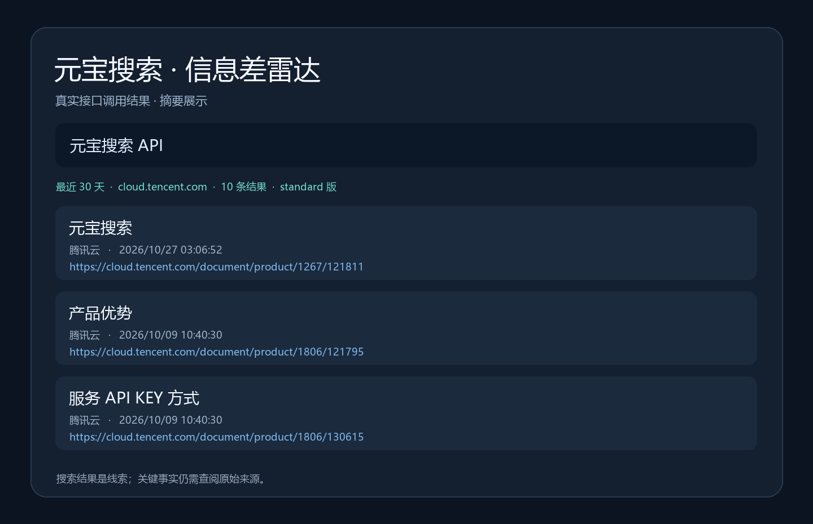

# 元宝搜索 · 信息差雷达

一个面向 Codex 的检索技能，使用腾讯云元宝搜索 SearchPro 接口，帮助进行新闻、时效信息和广泛调研。它提供精简检索结果、时间和站点筛选，并要求对关键结论回到原始来源核实。

这是独立开发的工具，并非腾讯云官方项目。搜索结果是线索，不保证真实、完整或实时；研究者仍需核对原始来源。搜索会消耗服务配额，费用与账户套餐有关。

## 安装和配置

需要 Python 3.9 或更高版本，以及已开通的腾讯云元宝搜索服务。没有第三方 Python 依赖。

```powershell
git clone https://github.com/yangwei251003/yuanbao-search-skill.git
Copy-Item -Recurse .\yuanbao-search-skill "$env:USERPROFILE\.codex\skills\yuanbao-search"
python "$env:USERPROFILE\.codex\skills\yuanbao-search\scripts\yuanbao_search.py" --store-key
```

最后一条命令会隐藏输入，在 Windows 使用当前账户的 DPAPI 加密存储密钥。不要把密钥写入命令参数、仓库或截图。也可以用受保护的环境变量 `TENCENTCLOUD_WSA_APIKEY`；设置后它优先于本地加密存储。其他操作系统可使用环境变量。更换密钥时重新运行 `--store-key`。

## 使用示例

```powershell
python "$env:USERPROFILE\.codex\skills\yuanbao-search\scripts\yuanbao_search.py" "元宝搜索 API 最新文档"
python "$env:USERPROFILE\.codex\skills\yuanbao-search\scripts\yuanbao_search.py" "元宝搜索" --freshness d30 --site cloud.tencent.com
```

可以在 Codex 中请求使用 `$yuanbao-search` 搜索并核实某个问题。输出是 JSON，默认保留标题、网址、日期、站点及摘要；传 `--full` 返回完整字段。`--help` 列出其他参数。极速版不支持 `--count`、`--industry` 和 `--mode`，以腾讯云当前文档为准。



## 验证

```powershell
python -m unittest discover -s tests
```

测试覆盖响应解析、时间参数、凭据回显脱敏、重定向保护和 Windows 加密存储。真实 API 调用需要有效密钥及已开通的服务。

## 官方资料与更新

- [腾讯云服务 API Key 接入](https://cloud.tencent.com/document/product/1806/130615)
- [SearchPro 参数说明](https://cloud.tencent.com/document/api/1806/121811)
- 2026-10-28：初版，接入 SearchPro、Windows 加密存储、检索与核验流程。

代码以 MIT 协议发布；腾讯云服务及返回内容适用其各自条款。
